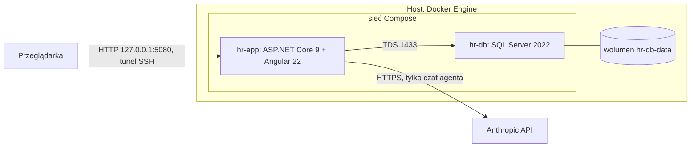

# Asystent kadrowo-płacowy

Aplikacja webowa do obsługi kadr i płac małej firmy, z agentem AI (model Claude) odpowiadającym na pytania na podstawie danych i Kodeksu pracy.
Pracownik składa wnioski urlopowe i wpisuje czas pracy, kierownik je zatwierdza, kadry obsługują zmiany płacowe i korekty ewidencji, a każdy widzi własne
naliczenia i może zapytać agenta (np. „Ile dni urlopu mi zostało?”). Wszystkie dane w repozytorium są syntetyczne, a naliczenia mają charakter
**wstępny i demonstracyjny**: nie stanowią porady prawnej ani kadrowo-płacowej.



Stan: zrealizowane plany 1–7d (domena, reguły, API, agent, interfejs Angular w stylu „Material Dashboard”) i Docker Compose. Następny etap: testy E2E (Playwright).
Dokumentacja architektury (arc42): [`docs/arc42`](docs/arc42/README.md).

## Wymagania

Do uruchomienia wystarczy Docker Engine. Dotnet, node i npm na hoście **nie są potrzebne**: aplikacja jest budowana w kontenerach.

| Wymaganie | Wartość |
|---|---|
| System | Linux x86_64 (sprawdzone: Ubuntu 22.04) |
| Docker Engine | 24 lub nowszy (sprawdzone: 24.0.9) z wtyczką **Compose v2**, polecenie `docker compose` (sprawdzone: 2.40.3; wymagane `up --wait`, czyli Compose v2 ≥ 2.20) |
| Uprawnienia | Dostęp do demona Dockera bez `sudo` (użytkownik w grupie `docker`); sprawdź: `docker info` |
| Programy pomocnicze | `bash`, `curl`, `ss` (iproute2), `python3` (używają ich skrypty i test dymny), `git` |
| Pamięć | Wolne ok. 2 GB RAM dla SQL Server (minimum wymagane przez Microsoft), zalecane 4 GB; w spoczynku `hr-db` zajmuje ok. 0,9 GB, `hr-app` ok. 0,1 GB |
| Dysk | Ok. 6 GB: obrazy (SQL Server 1,7 GB, obraz aplikacji ok. 0,3 GB, obrazy budujące `node:24` i `dotnet/sdk:9.0` oraz cache budowania) i wolumen bazy (ok. 0,3 GB) |
| Port | Wolny port **5080** na adresie `127.0.0.1` hosta |
| Internet hosta | Tylko przy pierwszym budowaniu (pobranie obrazów i pakietów npm/NuGet); potem uruchamianie systemu działa offline (przebudowanie po zmianie zależności, np. `package.json` lub `*.csproj`, znów wymaga internetu), z wyjątkiem czatu agenta, który wymaga HTTPS do Anthropic API |
| Przeglądarka | Dowolna nowoczesna; **nie potrzebuje internetu** (fonty i ikony są hostowane razem z aplikacją) |

## Szybki start

```bash
git clone https://github.com/99996927/TePePwEduPL.git
cd TePePwEduPL

# (opcjonalnie) klucz Anthropic dla czatu agenta, patrz „Klucz Anthropic i plik .env”
tools/docker/up.sh
```

`up.sh` sprawdza wymagania, tworzy plik `.env` z losowym hasłem bazy, buduje obraz, uruchamia bazę i aplikację, a potem sam wykonuje test dymny
(logowanie, urlopy, naliczenia, rozmowy demo) i kontrole konfiguracji. Pierwszy start trwa kilka minut (u nas: budowanie obrazu ok. 1,5 min,
start systemu ok. 40 s, przy już pobranych obrazach bazowych); kolejne są szybkie dzięki cache warstw. Poprawny przebieg kończy się tak:

```
Test dymny zakończony powodzeniem.
...
Wszystkie kontrole przeszły.

==> Gotowe
Aplikacja: http://localhost:5080  ...
```

Aplikacja jest wtedy dostępna pod `http://127.0.0.1:5080` na tym hoście. Zaloguj się kontem demo (tabela niżej).

## Dostęp z innego komputera (tunel SSH)

Aplikacja nasłuchuje **wyłącznie na `127.0.0.1`** hosta (nie jest widoczna w sieci), więc z innego komputera łączysz się tunelem SSH:

```bash
ssh -N -L 5080:127.0.0.1:5080 <użytkownik>@<host>
```

Zostaw to okno otwarte i wejdź w przeglądarce na `http://localhost:5080`. `up.sh` wypisuje gotową komendę z Twoim użytkownikiem i nazwą hosta.

## Klucz Anthropic i plik `.env`

Wszystkie sekrety są w pliku `.env` w katalogu głównym repozytorium. Plik jest w `.gitignore` (nie trafia do repozytorium), nie jest kopiowany do obrazu
Dockera (`.dockerignore`), ma uprawnienia `600`, a skrypty nigdy nie wypisują jego wartości ani nie przekazują ich w argumentach poleceń.

| Zmienna | Znaczenie |
|---|---|
| `HR_DB_PASSWORD` | Hasło administratora bazy (`sa`). Generuje je `up.sh` przy pierwszym uruchomieniu; nie wpisuj go ręcznie. Hasło jest związane z wolumenem bazy. |
| `ANTHROPIC_API_KEY` | Klucz do Anthropic API, **opcjonalny**. Dopisz ręcznie jeden wiersz: `ANTHROPIC_API_KEY=sk-ant-...` |

- **Bez klucza** wszystko działa, a czat agenta zwraca komunikat „Agent jest chwilowo niedostępny” (HTTP 503).
- **Dodanie lub zmiana klucza:** edytuj `.env` i uruchom `tools/docker/up.sh` ponownie. Odtworzony zostanie tylko kontener aplikacji, baza i dane zostają.
- `.env` jest **jedynym źródłem** tych wartości: zmienne `HR_DB_PASSWORD` i `ANTHROPIC_API_KEY` wyeksportowane w powłoce są przez `up.sh` ignorowane.
- Kopię zapasową `.env` trzymaj poza repozytorium (np. `~/.hr.env`); wzorce `.env*` są w `.gitignore` i `.dockerignore`, ale to ostatnia linia obrony.
- Wzór pliku: `.env.example` (bez wartości).

## Konta demo

Dane demo (31 osób w pięciu zespołach, ewidencja czasu, urlopy, zmiany płacowe, naliczenia za kwiecień–wrzesień 2026, rozmowy z agentem) są zakładane przy
pierwszym starcie. Pełny opis: [`docs/arc42/07-widok-wdrozenia.md`](docs/arc42/07-widok-wdrozenia.md), sekcje 7.2–7.3.

| Login | Hasło | Rola |
|---|---|---|
| `anna.nowak` | `annanowak123` | pracownik |
| `jan.kowalski` | `jankowalski123` | pracownik |
| `tomasz.lis` | `tomaszlis123` | pracownik (inny zespół) |
| `ewa.wisniewska` | `ewawisniewska123` | kierownik |
| `piotr.zielinski` | `piotrzielinski123` | kadry |
| `maria.kaminska` | `mariakaminska123` | zatwierdzająca kadr |

> **Ostrzeżenie:** hasła są jawne i przewidywalne, a polityka haseł jest świadomie poluzowana (decyzja ADR-06, ryzyko R-03).
> Nie wystawiaj tej instancji do internetu.

## Codzienna obsługa

| Cel | Polecenie |
|---|---|
| Uruchomić lub zaktualizować system (po zmianie kodu, `.env`) | `tools/docker/up.sh` (można wielokrotnie; nie dubluje danych) |
| Zatrzymać (dane zostają) | `tools/docker/down.sh` |
| Zatrzymać i usunąć bazę (czysty stan, dane demo od nowa) | `tools/docker/down.sh --reset` |
| Stan kontenerów | `docker ps --filter name=hr-` |
| Logi aplikacji / bazy | `docker logs -f hr-app` / `docker logs -f hr-db` |
| Powtórzyć kontrole konfiguracji | `tools/docker/verify.sh` |
| Powtórzyć test dymny | `tools/dev/smoke.sh http://127.0.0.1:5080` |

Kontenery mają `restart: unless-stopped`, więc po restarcie maszyny (i usłudze Docker) wstają same. Dane bazy są w wolumenie `hr-db-data` (`docker volume inspect hr-db-data`);
przeżywają `down.sh` i przebudowanie obrazu, a znikają tylko po `down.sh --reset`. Klucze sesji aplikacji są w wolumenie `hr-app-keys`, więc zalogowani użytkownicy nie są wylogowywani po `up.sh`, który odtwarza kontener aplikacji (po `--reset` trzeba zalogować się ponownie).
Zmiany wprowadzone podczas testów ręcznych zostają w bazie.

## Warunki działania i ograniczenia

- To instancja **demonstracyjna** (środowisko `Production` z włączonym zasiewem danych demo, `Hr__SeedDemoData=true`), nie wdrożenie produkcyjne.
- Komunikacja jest po zwykłym HTTP na loopbacku, bez TLS, i nie ma żadnej dodatkowej warstwy uwierzytelniania przed aplikacją (poza logowaniem do niej); ochroną jest ograniczenie do `127.0.0.1` i tunel SSH. Nie publikuj portu na inne adresy.
- Jedna instancja aplikacji (zasiew danych zakłada, że startuje jedna).
- Hasło `sa` jest ustalane przy zakładaniu wolumenu. Utrata lub zmiana `.env` przy istniejącym wolumenie powoduje błąd logowania do bazy (patrz niżej).
- Port 5080 jest wspólny z deweloperskim `tools/dev/run.sh`: nie uruchamiaj ich jednocześnie (`up.sh` odmówi startu, jeśli port jest zajęty).
- Baza działa na wolumenie Dockera tego hosta; nie ma kopii zapasowych.

## Rozwiązywanie problemów

| Objaw | Przyczyna | Co zrobić |
|---|---|---|
| `Docker nie odpowiada (czy usługa działa i czy masz uprawnienia do docker?)` | Usługa Docker nie działa albo brak uprawnień | `sudo systemctl start docker`; dodaj użytkownika do grupy `docker` (`sudo usermod -aG docker $USER`) i zaloguj się ponownie |
| `brak wtyczki Docker Compose v2` | Brak `docker compose` | Zainstaluj Compose v2: `sudo apt install docker-compose-v2` (Ubuntu; w dystrybucjach z repozytorium Dockera pakiet `docker-compose-plugin`) |
| `port 5080 jest zajęty przez inny program` | Działa `tools/dev/run.sh` albo inny program | `tools/dev/stop.sh`, albo `ss -ltnp 'sport = :5080'` i zakończ proces |
| `hasło bazy z .env nie pasuje do bazy w istniejącym wolumenie` | `.env` zginął lub się zmienił, a wolumen z bazą został | Przywróć poprzedni `.env` albo `tools/docker/down.sh --reset && tools/docker/up.sh` (usuwa dane) |
| `hr-db` nie osiąga stanu zdrowego, w logach brak pamięci | SQL Server wymaga ok. 2 GB RAM | Zwolnij pamięć na hoście i uruchom `up.sh` ponownie |
| Budowanie kończy się błędem sieci (pobieranie obrazów, npm, NuGet) | Host nie ma dostępu do internetu | Pierwsze budowanie wymaga internetu; po przywróceniu połączenia uruchom `up.sh` ponownie |
| Czat agenta: „Agent jest chwilowo niedostępny” (503) | Brak `ANTHROPIC_API_KEY` w `.env`, zły klucz albo brak HTTPS do Anthropic | Dopisz poprawny klucz do `.env` i uruchom `up.sh`; reszta systemu działa bez klucza |
| Strona się nie ładuje przez tunel | Tunel SSH zamknięty lub zajęty lokalny port 5080 | Uruchom tunel ponownie; użyj innego portu lokalnego (`-L 8080:127.0.0.1:5080`, adres `http://localhost:8080`) |

## Dla programistów

- **Szybka pętla bez budowania obrazu:** `tools/dev/run.sh` (wymaga .NET SDK 9, Node `^24.15.0`, Dockera): baza w kontenerze `hr-dev-db`, Angular zbudowany do `wwwroot`, `Hr.Api` w tle na tym samym porcie 5080; `tools/dev/stop.sh [--reset]`. Szczegóły: [`docs/arc42/07-widok-wdrozenia.md`](docs/arc42/07-widok-wdrozenia.md), sekcja 7.4.
- **Testy:** `dotnet test Hr.sln` (xUnit; testy integracyjne używają Testcontainers, więc wymagają Dockera) oraz `cd web && npm run verify` (spójność klienta API, testy Vitest, build produkcyjny, kontrola braku zasobów zewnętrznych).
- **Struktura:** `src/Hr.Core`, `Hr.Rules`, `Hr.Agent`, `Hr.Api` (serwuje też Angulara z `wwwroot`), `web/` (Angular, patrz [`web/README.md`](web/README.md)), `tests/`, `tools/`.
- **Dokumentacja:** [`docs/arc42`](docs/arc42/README.md) (architektura i decyzje), `docs/superpowers` (specyfikacje i plany), `docs/testy-reczne` (kroki testów ręcznych, m.in. [`docker.md`](docs/testy-reczne/docker.md)).
