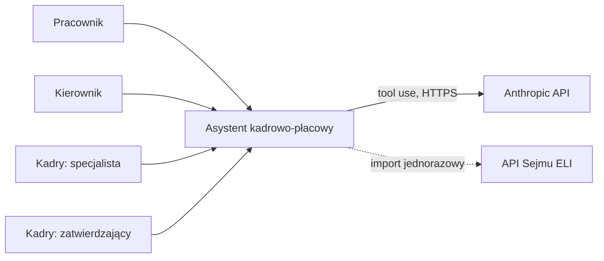

# 3. Kontekst i zakres systemu

## 3.1 Kontekst biznesowy
| Aktor / system | Rola | Wymiana |
|---|---|---|
| Pracownik | Użytkownik | Składa wnioski, rejestruje czas pracy, pyta agenta, przegląda swoje naliczenia. |
| Kierownik | Użytkownik | Zatwierdza wnioski zespołu, przegląda ewidencję i alerty zespołu. |
| Kadry — specjalista | Użytkownik | Uruchamia naliczenia, tworzy zmiany płacowe i korekty. |
| Kadry — zatwierdzający | Użytkownik | Zatwierdza lub odrzuca zmiany płacowe (druga osoba). |
| Anthropic API | System zewnętrzny | Model językowy agenta (tool use). |
| API Sejmu (ELI) | System zewnętrzny | Jednorazowe pobranie tekstu Kodeksu pracy (import, nie w czasie działania). |

## 3.2 Kontekst techniczny
| Kanał | Protokół | Uwagi |
|---|---|---|
| Przeglądarka → aplikacja | HTTP(S), REST/JSON | Angular i API pod jednym originem. |
| Aplikacja → MSSQL | TDS (port 1433), sieć Docker | Port bazy niewystawiony na zewnątrz hosta. |
| Aplikacja → Anthropic | HTTPS | Klucz API w zmiennej środowiskowej. |

## 3.3 Zakres
**W zakresie:** wnioski urlopowe, ewidencja czasu pracy, wstępne naliczenia, agent AI, role i separacja danych, dwuosobowe zatwierdzanie zmian płacowych, audyt.

**Poza zakresem:** integracja z ZUS/US, deklaracje podatkowe, prawdziwe dane osobowe, rozliczenia zgodne z aktualnymi stawkami podatkowymi, wiele firm (multi-tenancy), zewnętrzny SSO.

## 3.4 Aktorzy i role
| Rola systemowa | Konta demo | Zakres danych |
|---|---|---|
| `Employee` | anna.nowak, jan.kowalski, tomasz.lis | Tylko własne. |
| `Manager` | ewa.wisniewska | Własne i zespołu (Anna, Jan). |
| `HR` | piotr.zielinski | Wszyscy pracownicy, tworzy zmiany płacowe. |
| `HRApprover` | maria.kaminska | Wszyscy pracownicy, zatwierdza zmiany płacowe (nie własne). |

## 3.5 Katalog przypadków użycia
Podstawa prawna oznaczona ✔ została zweryfikowana w tekście jednolitym Kodeksu pracy (Dz.U. 2026 poz. 1245).
Pozostałe zapisy wymagają weryfikacji przed implementacją reguły.

### A. Logowanie i dostęp
| ID | Przypadek | Aktor | Oczekiwany wynik |
|---|---|---|---|
| UC-01 | Logowanie poprawne | każdy | Każde z 6 kont demo loguje się swoim hasłem i widzi panel właściwy dla roli. |
| UC-02 | Logowanie błędne | każdy | Komunikat o błędzie, brak sesji, czasowa blokada po kilku nieudanych próbach. |
| UC-03 | Separacja danych | Employee, Manager | `tomasz.lis` nie widzi danych Anny (UI i API: 403/404). `ewa.wisniewska` widzi Annę i Jana, nie widzi Tomasza. |
| UC-04 | Dostęp do paneli wg roli | Employee | Pracownik nie otwiera panelu kadr (przekierowanie lub 403). |

### B. Urlopy
| ID | Przypadek | Aktor | Oczekiwany wynik |
|---|---|---|---|
| UC-05 | Podgląd salda urlopowego | Employee | Wymiar 20 dni (staż poniżej 10 lat) lub 26 dni (od 10 lat) ✔ art. 154 § 1, dni wykorzystane i pozostałe. |
| UC-06 | Złożenie wniosku urlopowego | Employee | Silnik liczy dni robocze (bez weekendów i świąt), wniosek trafia do kierownika. |
| UC-07 | Wniosek ponad saldo | Employee | System odrzuca wniosek z komunikatem o braku dni. |
| UC-08 | Zatwierdzenie/odrzucenie wniosku | Manager | Zatwierdzenie zmniejsza saldo, odrzucenie wymaga uzasadnienia. Brak dostępu do wniosków spoza zespołu. |
| UC-09 | Anulowanie wniosku | Employee | Możliwe do czasu zatwierdzenia. |

### C. Czas pracy
| ID | Przypadek | Aktor | Oczekiwany wynik |
|---|---|---|---|
| UC-10 | Wpis czasu pracy | Employee | Rejestracja godzin, wyliczenie godzin nadliczbowych ✔ art. 151 § 1. |
| UC-11 | Korekta wpisu | Employee, HR | Korekta z powodem, zapis w historii audytowej. |
| UC-12 | Naruszenie odpoczynku dobowego | system | Mniej niż 11 h między dniami pracy → alert ✔ art. 132 § 1. |
| UC-13 | Naruszenie odpoczynku tygodniowego | system | Mniej niż 35 h w tygodniu → alert ✔ art. 133 § 1. |
| UC-14 | Przekroczenie średniej 48 h | system | Średnio ponad 48 h tygodniowo łącznie z nadgodzinami w okresie rozliczeniowym → alert ✔ art. 131 § 1. Norma: 8 h na dobę i przeciętnie 40 h tygodniowo ✔ art. 129 § 1. |
| UC-15 | Przegląd zespołu | Manager | Zbiorcza ewidencja i alerty zespołu. |

### D. Wynagrodzenia (wstępne naliczenie)
| ID | Przypadek | Aktor | Oczekiwany wynik |
|---|---|---|---|
| UC-16 | Wstępne naliczenie miesiąca | HR | Wyliczenie składników wraz z dodatkami za nadgodziny ✔ art. 151¹, wynik powtarzalny dla tych samych danych. |
| UC-17 | Podgląd naliczenia przez pracownika | Employee | Tylko własne naliczenie. |
| UC-18 | Zmiana płacowa (dwa kroki) | HR, HRApprover | `piotr.zielinski` tworzy zmianę stawki lub składnika wynagrodzenia pracownika (z datą obowiązywania i uzasadnieniem), `maria.kaminska` ją zatwierdza. Zmiana działa od daty obowiązywania, ale dopiero po zatwierdzeniu. |
| UC-19 | Zakaz samozatwierdzenia | HR, HRApprover | Ta sama osoba nie może zatwierdzić własnej zmiany. Błąd także przy bezpośrednim wywołaniu API. |
| UC-20 | Odrzucenie zmiany płacowej | HRApprover | Odrzucenie z uzasadnieniem, zmiana nie wchodzi w życie. |

### E. Agent AI
| ID | Przypadek | Aktor | Oczekiwany wynik |
|---|---|---|---|
| UC-21 | Pytanie o urlop | Employee | Odpowiedź z liczbą z silnika, zgodną z UC-05. |
| UC-22 | Pytanie o nadgodziny | Employee | Liczba pochodzi z wywołania narzędzia, nie z obliczeń modelu. |
| UC-23 | Pytanie o przepisy | Employee | Agent cytuje przepis z numerem artykułu (np. art. 129, 131) i źródłem. |
| UC-24 | Separacja w agencie | Employee | Pytanie o dane innej osoby kończy się odmową, narzędzia działają w kontekście uprawnień użytkownika. |
| UC-25 | Awaria silnika | Employee | Agent nie zgaduje liczby, informuje o błędzie. |
| UC-26 | Szkic korekty dla kadr | HR | Po wykryciu naruszenia agent tworzy szkic korekty **ewidencji czasu pracy** (nie wynagrodzenia). Dane nie zmieniają się do czasu zatwierdzenia przez kadry. |
| UC-27 | Pytanie poza zakresem | każdy | Agent odmawia grzecznie i wskazuje dział kadr. |
| UC-30 | Historia własnych rozmów | Employee, Manager | Użytkownik widzi pełną historię swoich rozmów z agentem i może do niej wrócić (ciągłość dopytań). Nie widzi rozmów innych osób (UI i API: 403/404). |
| UC-31 | Odczyt rozmów przez kadry | HR, HRApprover | Kadry mogą otworzyć pełną treść rozmowy dowolnego pracownika (pytania, odpowiedzi, wywołania narzędzi). Kierownik tego dostępu nie ma. Każdy odczyt jest zapisywany w audycie. |

### F. Administracja i audyt
| ID | Przypadek | Aktor | Oczekiwany wynik |
|---|---|---|---|
| UC-28 | Dziennik audytowy | HR | Widok: kto, kiedy, co zmienił, w tym wywołania narzędzi przez agenta. |
| UC-29 | Dane demo po starcie | operator | Po `docker compose up` baza zawiera konta i dane syntetyczne, a ekran logowania odpowiada. |
