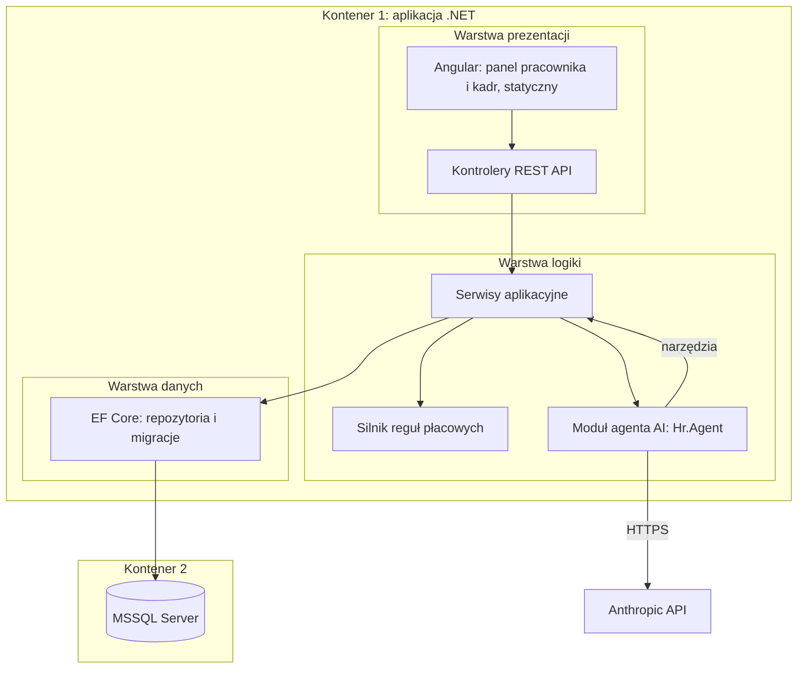
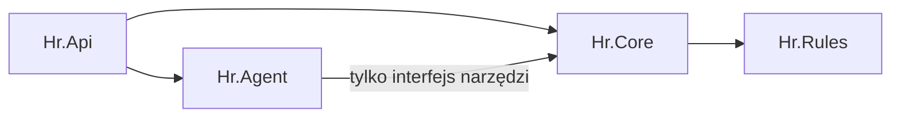
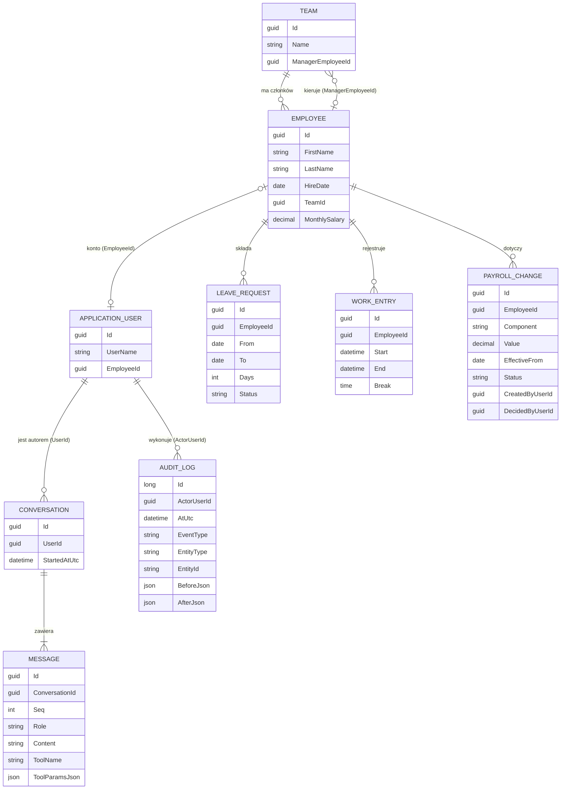

# 5. Widok bloków budulcowych

> **Status:** architektura backendu (5.2–5.4) uzgodniona z właścicielem projektu: cztery projekty, cookie sesyjne, pełna historia rozmów agenta.

## 5.1 Poziom 1 — trzy warstwy

| Blok | Odpowiedzialność |
|---|---|
| Angular | Panel pracownika (wnioski, czas, agent, naliczenia) i panel kadr (naliczenia, zmiany płacowe, audyt). Zbudowany do plików statycznych. |
| Kontrolery REST API | Uwierzytelnianie, autoryzacja po rolach, walidacja żądań, mapowanie DTO. |
| Serwisy aplikacyjne | Przypadki użycia (wnioski, ewidencja, naliczenia, zmiany płacowe), sprawdzanie zakresu danych (własne, zespół, wszystkie). |
| Silnik reguł płacowych | Czyste, deterministyczne reguły: dni robocze, saldo urlopu, nadgodziny, normy czasu pracy, dodatki, naliczenie. Bez I/O. |
| Moduł agenta | Pętla tool use z Anthropic API, definicje narzędzi, ograniczenie do uprawnień użytkownika, zapis wywołań w audycie. |
| Warstwa danych | Encje, EF Core, migracje, seed kont i danych demo. |

## 5.2 Poziom 2 — backend: cztery projekty .NET

| Projekt | Zależności | Zawartość |
|---|---|---|
| `Hr.Api` | Core, Agent | Kontrolery REST, ASP.NET Core Identity (cookie sesyjne), serwowanie statycznego Angulara, `Program.cs`, kompozycja zależności. Przekazuje agentowi tożsamość użytkownika. |
| `Hr.Core` | Rules | Domena (pracownik, wniosek, wpis czasu, naliczenie, zmiana płacowa, rozmowa), serwisy aplikacyjne, autoryzacja zakresu danych, EF Core, migracje, seed, import Kodeksu pracy, audyt. Wystawia interfejs narzędzi dla agenta. Nie zna projektu `Agent`. |
| `Hr.Rules` | brak | Silnik reguł płacowych: czyste funkcje, `decimal`, parametry wg daty. Bez I/O. |
| `Hr.Agent` | Core (tylko interfejs narzędzi) | Klient Anthropic API, pętla tool use, instrukcja systemowa, zapis rozmowy przez interfejs z `Core`. Nie ma dostępu do bazy ani do silnika reguł. |
| `Hr.Tests.*` | — | Testy jednostkowe reguł, integracyjne, autoryzacji, kontraktu agenta i architektury. |

Zasada zależności: `Hr.Rules` nie zależy od niczego. `Hr.Core` nie zna `Hr.Agent`. `Hr.Agent` korzysta wyłącznie z interfejsu narzędzi.
Referencja projektu nie ogranicza widoczności typów publicznych, więc granica jest dodatkowo wymuszana **testem architektury**
(np. NetArchTest): `Hr.Agent` nie może używać typów `Hr.Core` spoza przestrzeni nazw interfejsu narzędzi ani `Hr.Rules`.

## 5.3 Silnik reguł płacowych (czarna skrzynka)
- **Wejście:** niemutowalne dane (wpisy czasu, rozkład, parametry zatrudnienia, data, parametry reguł).
- **Wyjście:** wynik z identyfikatorem reguły i odwołaniem do artykułu (np. `KP-129-1`, `KP-130-1`, `KP-131-1`, `KP-132-1`, `KP-133-1`, `KP-151-1`, `KP-151-1-1`, `KP-154-1`).
- **Własności:** czysty (brak efektów ubocznych), deterministyczny, wersjonowany po dacie obowiązywania, pokryty testami.
- **Okresy rozliczeniowe:** parametr (do 4 miesięcy, w uzasadnionych przypadkach do 12 miesięcy ✔ art. 129 § 1–2).

## 5.4 Moduł agenta (`Hr.Agent`) i interfejs narzędzi (`Hr.Core`)
Narzędzia (wstępna lista): `get_leave_balance`, `calculate_overtime`, `check_work_time_violations`,
`search_labour_code`, `propose_correction`. Każde wywołuje serwis aplikacyjny w kontekście zalogowanego użytkownika
(tożsamość z sesji, nie od modelu). `propose_correction` tworzy tylko szkic.

**Historia rozmów:** każda rozmowa (pytania, odpowiedzi, wywołania narzędzi z parametrami i wynikiem) jest zapisywana w bazie
i powiązana z użytkownikiem. Autor czyta swoje rozmowy. Kadry (`HR`, `HRApprover`) mogą czytać pełną treść każdej rozmowy (ADR-11).
Kierownik i inni pracownicy nie mają dostępu do cudzych rozmów.
Szczegóły przebiegu w [sekcji 6](06-widok-czasu-wykonania.md).

## 5.5 Model danych (zrealizowany w planie 2)

- **Ograniczenia w bazie:** `CK_LeaveRequest_Period`, `CK_LeaveRequest_Days`, `CK_WorkEntry_Period`, `CK_WorkEntry_Break`, `CK_PayrollChange_Value`
  `CK_PayrollChange_FourEyes` (`DecidedByUserId` różne od `CreatedByUserId`, ADR-08) oraz `CK_PayrollChange_Decision` (zatwierdzona lub odrzucona zmiana musi mieć osobę decydującą, niezdecydowana jej nie ma). Unikalny indeks `(ConversationId, Seq)` na `Message`.
- **`AuditLog`:** tylko do dopisywania, wyzwalacz `TR_AuditLog_AppendOnly` (ADR-13). Wpisy dla encji `IAuditable` (`Team`, `Employee`, `LeaveRequest`, `WorkEntryRecord`, `PayrollChange`)
  dopisuje interceptor w tej samej transakcji.
- **Zakres danych:** `DataScope` (pracownicy i dane z `IEmployeeOwned`) oraz `ConversationAccess` budują filtry jako zapytania SQL. Brak powiązanego pracownika lub nierozpoznana rola daje pusty wynik (fail closed).
- **Klucze obce użytkownika:** `Conversation.UserId` i `PayrollChange.CreatedByUserId`/`DecidedByUserId` to na razie zwykłe `Guid` bez klucza obcego do tabeli kont. Walidację dodają serwisy aplikacyjne (plan 3).
- **Jeszcze niezrealizowane:** wyniki naliczeń (`PayrollRun`), artykuły Kodeksu pracy (import) i dane generowane (ADR-19 do ADR-21).
