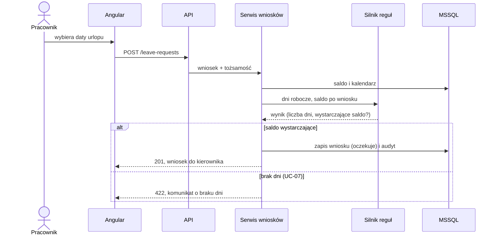
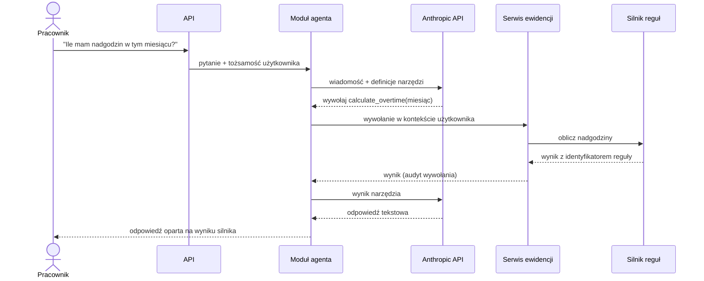
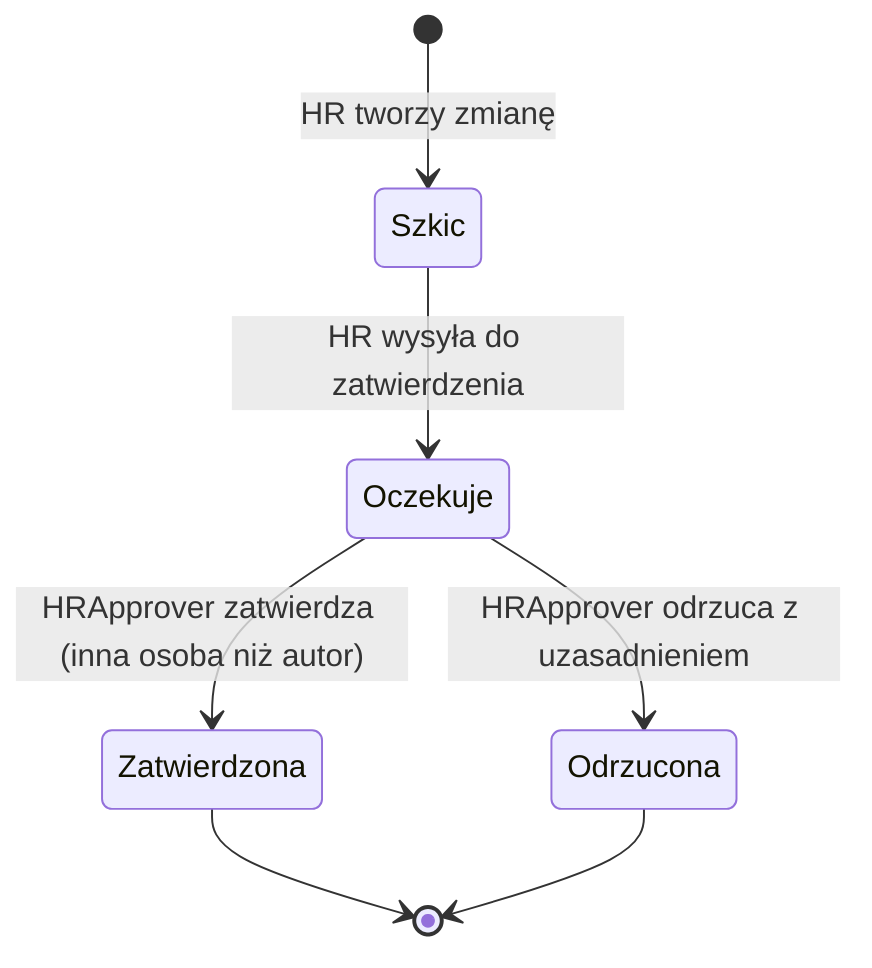
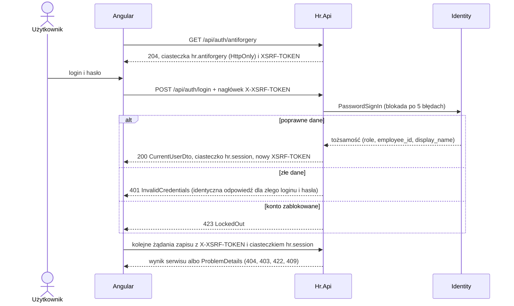

# 6. Widok czasu wykonania

## 6.1 UC-06 Złożenie wniosku urlopowego

**Realizacja:** `LeaveService.SubmitAsync` (ADR-24). Kody błędów: brak powiązania z pracownikiem to `Forbidden`; odwrócone daty, przekroczenie roku, 0 dni roboczych i brak salda (z `KP-154-1`) to `Validation`; nakładanie na wniosek oczekujący lub zatwierdzony to `Conflict`.

## 6.2 UC-12/14 Wykrycie naruszeń czasu pracy
Silnik analizuje wpisy czasu: odpoczynek dobowy (11 h, art. 132 § 1), tygodniowy (35 h, art. 133 § 1) i średnią tygodniową
w okresie rozliczeniowym (48 h łącznie z nadgodzinami, art. 131 § 1). Wynik to lista naruszeń z identyfikatorem reguły,
datą i wartościami. Trafia do alertów pracownika i kierownika oraz do szkiców korekt dla kadr.

## 6.3 UC-22 Pytanie agenta o nadgodziny

**Odpowiedź w całości:** UI wysyła zwykłe żądanie POST i pokazuje wskaźnik „agent pisze…”. Odpowiedź wraca po zakończeniu pętli narzędzi (ADR-14).

**Historia:** pytanie, wywołania narzędzi i odpowiedź są zapisywane w rozmowie użytkownika (ADR-11), a kolejne pytania dostają kontekst z historii.

**Zasada:** odpowiedź może zawierać liczby wyłącznie z wyników narzędzi. Przy błędzie narzędzia agent informuje o błędzie (UC-25).
Parametr identyfikujący pracownika nie pochodzi od modelu, tylko z sesji użytkownika (UC-24).

## 6.4 UC-18/19 Zmiana płacowa z dwuosobowym zatwierdzeniem
Zmiana dotyczy stawki lub składnika wynagrodzenia konkretnego pracownika. Ma datę obowiązywania i uzasadnienie (ADR-15).
Silnik reguł używa nowej wartości od tej daty, tylko dla zmian w stanie „Zatwierdzona”.

Kontrola „autor ≠ zatwierdzający” jest realizowana w serwisie i dodatkowo ograniczeniem w bazie. Obie operacje trafiają do audytu.

## 6.5 UC-26 Szkic korekty przygotowany przez agenta
Agent wywołuje `check_work_time_violations`, a następnie `propose_correction`. Narzędzie zapisuje szkic korekty **wpisu czasu pracy**
ze statusem „do przeglądu”. Dane źródłowe (ewidencja, naliczenia) nie są zmieniane. Korektę przegląda i zatwierdza człowiek z kadr (UC-11).
Po zatwierdzeniu zmienia się wpis czasu, a naliczenie można uruchomić ponownie na poprawionych danych (UC-16).
Zmiany stawek i składników wynagrodzenia przechodzą osobny przepływ dwuosobowy według 6.4 i nie są tworzone przez agenta.

## 6.6 UC-01/02 Logowanie z ochroną antyforgery

Token antyforgery jest związany z tożsamością, dlatego po zalogowaniu i wylogowaniu API wystawia nowy `XSRF-TOKEN`.
