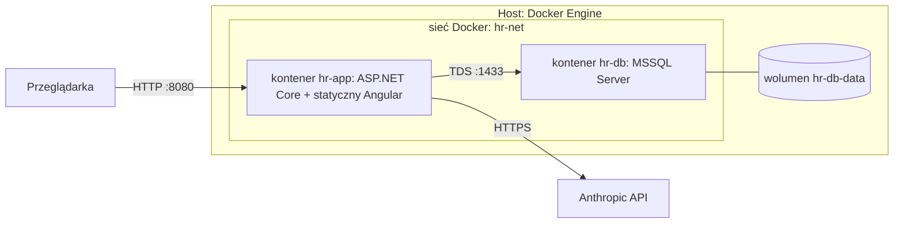

# 7. Widok wdrożenia

## 7.1 Infrastruktura
Jedna maszyna Linux (x86_64, 4 vCPU, 32 GB RAM), Docker Engine 24.0.9 i Docker Compose v2 (2.40.3).

| Element | Opis |
|---|---|
| `hr-app` | Obraz wieloetapowy: build Angulara, publikacja .NET, runtime ASP.NET. Wystawia port aplikacji. |
| `hr-db` | Obraz Microsoft SQL Server (Linux). Port 1433 tylko w sieci Docker, nie na hoście. Dane w wolumenie. |
| Sekrety | Klucz Anthropic API i hasło SA bazy z pliku `.env` (poza repozytorium, w `.gitignore`). |
| Start | `docker compose up`: kontener bazy, potem aplikacja z migracjami i seedem (UC-29). Healthcheck bazy. |

**Klucz Anthropic API:** aplikacja czyta go z `Anthropic:ApiKey` (konfiguracja) albo ze zmiennej środowiskowej `ANTHROPIC_API_KEY`; model z `Anthropic:Model` (domyślnie `claude-sonnet-5-5`). Lokalnie: `export ANTHROPIC_API_KEY=...` przed `dotnet run`, przy `tools/dev/run.sh` wiersz `ANTHROPIC_API_KEY=...` w `.env` (sekcja 7.4), w Dockerze przez `.env` (plik jest w `.gitignore`; wzorzec `.env.example` nie zawiera wartości). Bez klucza endpointy agenta zwracają `503`, a reszta systemu działa. Opcjonalny test na prawdziwym API (`LiveSmokeTests`) jest domyślnie pomijany: uruchom go zmienną `RUN_LIVE_SMOKE=1` z ustawionym kluczem.

## 7.2 Konta demo (wyłącznie środowisko demonstracyjne, dane syntetyczne)
Konta tworzone seedem przy zakładaniu bazy. Hasło ma postać `imięnazwisko123` (małe litery, bez znaków diakrytycznych).

| Login | Hasło | Rola | Uwagi |
|---|---|---|---|
| `anna.nowak` | `annanowak123` | Employee | W zespole Ewy. |
| `jan.kowalski` | `jankowalski123` | Employee | W zespole Ewy. |
| `tomasz.lis` | `tomaszlis123` | Employee | Inny zespół, test separacji danych. |
| `ewa.wisniewska` | `ewawisniewska123` | Manager | Kieruje `Zespołem Ewy` (Anna, Jan; w profilu `Full` także 4 wygenerowane osoby). |
| `piotr.zielinski` | `piotrzielinski123` | HR | Tworzy zmiany płacowe. |
| `maria.kaminska` | `mariakaminska123` | HRApprover | Zatwierdza zmiany płacowe. |

**Pozostałe konta (wygenerowani pracownicy, ADR-19 i ADR-20, tylko profil `Full`):** login `imię.nazwisko`, hasło `imięnazwisko123` (małe litery, bez znaków diakrytycznych).
Profil `Full` zakłada 31 osób w pięciu zespołach: cztery zespoły biznesowe (`Zespół Ewy`, `Zespół B`, `Zespół C`, `Zespół D`, po 7 osób) i `Kadry` (3 osoby).
Wygenerowane osoby mają rolę `Employee`, a każdy zespół biznesowy ma dokładnie jednego `Manager` (w `Zespole Ewy` jest nim `ewa.wisniewska`).
Zespół `Kadry` (Piotr `HR`, Maria `HRApprover` i jedna osoba `Employee`) nie ma kierownika; wnioski jego członków i kierowników zespołów rozpatruje kadra.
Lista kont jest wyznaczona regułą i ziarnem generatora, więc nie jest tu powielana. Profil `Accounts` zakłada wyłącznie sześć kont z tabeli powyżej.

> **Ostrzeżenie:** hasła są jawne i przewidywalne, a polityka haseł jest świadomie poluzowana (decyzja ADR-06, ryzyko R-03).
> Nie wolno używać tego zestawu poza środowiskiem demonstracyjnym.

## 7.3 Dane demo
Dane demo (UC-29) zakłada aplikacja przy starcie, po migracjach i imporcie Kodeksu pracy, wyłącznie gdy `Hr:SeedDemoData=true`.
Klucze sekcji `Hr:` można nadpisać zmiennymi środowiskowymi (np. `Hr__DemoAnchorDate`); wartości domyślne są w kodzie (`DemoOptions`), nie w `appsettings.json`.

| Klucz | Domyślnie | Znaczenie |
|---|---|---|
| `Hr:SeedDemoData` | `false` | Włącza seed kont i danych demo. |
| `Hr:DemoAnchorDate` | `2026-10-16` | Kotwica („dziś” danych demo, ADR-28); musi być dniem roboczym, format `yyyy-MM-dd`. |
| `Hr:DemoSeed` | `20261016` | Ziarno generatora (liczba całkowita). |
| `Hr:DemoProfile` | `Full` | `Full`: pełny zbiór (31 osób, ewidencja, urlopy, zmiany płacowe, rozmowy, naliczenia); `Accounts`: tylko 3 zespoły i 6 kont z sekcji 7.2, bez danych (używany przez testy API). |

Niepoprawna wartość (zła data, kotwica w weekend lub święto, ziarno niebędące liczbą, nieznany profil) zatrzymuje start aplikacji wyjątkiem z komunikatem po polsku.

**Zakres (profil `Full`, kotwica `2026-10-16`):** ewidencja czasu pracy od 1.04.2026 do kotwicy (tylko dni robocze według `WorkCalendar`, z pominięciem
zatwierdzonych urlopów), wnioski urlopowe, zmiany płacowe, dwie zapisane rozmowy z agentem oraz naliczenia za kwiecień–wrzesień 2026, które liczy
`PayrollService` (ADR-27). Za październik naliczeń nie ma: miesiąc kotwicy jest otwarty.

**Scenariusze stałe** (testy UC i E2E mogą polegać wyłącznie na nich):

| Konto | Scenariusz | UC |
|---|---|---|
| `anna.nowak` | Naruszenie odpoczynku dobowego (<11 h) w ustalonym dniu września i jedno naruszenie tygodniowego (<35 h); wpis do korekty przez kadry. | 11, 12, 13, 26 |
| `jan.kowalski` | Nadgodziny w kilku miesiącach, w jednym z przekroczoną średnią 48 h; staż 12 lat (26 dni). | 10, 14, 16 |
| `tomasz.lis` | Poprawny przebieg bez alertów; staż poniżej 10 lat (20 dni); rozmowa z agentem. | 3, 24 |
| Anna (urlopy) | Wniosek oczekujący, zatwierdzony na przyszłość i zrealizowany; saldo spójne z wnioskami (20 dni wymiaru, 10 zatwierdzonych, 5 oczekujących, 5 pozostałych). | 5, 6, 8, 9 |
| Jan (urlopy) | Wniosek odrzucony z uzasadnieniem i anulowany. | 8, 9 |
| `piotr.zielinski`, `maria.kaminska` | Zmiana płacowa oczekująca (do zatwierdzenia przez Marię), zatwierdzona historycznie i odrzucona; oczekująca nie jest tworzona i zatwierdzana przez tę samą osobę. | 18, 19, 20 |
| wszyscy | Naliczenia za kwiecień–wrzesień; października brak. | 16, 17 |
| `anna.nowak`, `piotr.zielinski` | Szkic korekty ewidencji (UC-26): oczekujący szkic Piotra dla wpisu Anny z dnia naruszenia odpoczynku dobowego (wtorek września), przesuwający zmianę 14:00–22:30 na 12:00–20:30, co daje 11 h odpoczynku. Szkic zatwierdzają kadry; jest dokładnie jeden. | 26 |
| agent | Zapisana rozmowa Anny (do odczytu przez kadry z audytem) i rozmowa Tomasza. | 30, 31 |

**Idempotencja i istniejące bazy:** dane są zapisywane w jednej transakcji tylko wtedy, gdy nie ma konta `anna.nowak`; naliczenia tylko dla miesięcy bez wyników.
Seed nigdy nie nadpisuje ani nie usuwa danych. Szkic korekty (tabela `CorrectionDrafts`) zakłada się razem z resztą danych demo, więc baza założona przed planem 7b go nie ma i nie dostaje go przy kolejnym starcie (znacznik seeda `anna.nowak` już istnieje); pełny zbiór ze szkicem daje `tools/dev/stop.sh --reset` i ponowne `run.sh` (zob. 7.4). Jeśli w bazie nie ma pełnego zbioru osób profilu `Full` (np. dawna baza z sześcioma kontami
albo baza założona profilem `Accounts`), naliczenia są pomijane z wpisem w logu, bo bez ewidencji byłyby puste.
Zmiana kotwicy lub ziarna działa wyłącznie na pustej bazie: w istniejącej bazie seed danych jest pomijany, a naliczenia powstają tylko dla miesięcy, które mają wpisy czasu pracy (pozostałe są pomijane z ostrzeżeniem w logu).
Dwie instancje aplikacji uruchomione jednocześnie na pustej bazie mogą się ścigać o znacznik seeda (konto `anna.nowak`), dlatego seed należy uruchamiać z jednej instancji.

**Audyt:** seed zapisuje przez `HrDbContext` z przechwytywaczem audytu i go nie wyłącza, więc jego wiersze (m.in. zespoły, pracownicy, wpisy czasu,
wnioski urlopowe, zmiany płacowe i naliczenia) mają w `AuditLog` wpisy z pustym aktorem (`ActorUserId = null`). To zamierzone: audyt pokazuje pochodzenie danych.

> **Ostrzeżenie (R-03):** wszystkie konta demo, także wygenerowane, mają jawne i przewidywalne hasła (`imięnazwisko123`), a polityka haseł jest poluzowana (ADR-06).
> Seed jest domyślnie wyłączony; włączaj go wyłącznie w środowisku demonstracyjnym z danymi syntetycznymi i nie wystawiaj takiej instancji do internetu.

## 7.4 Uruchomienie deweloperskie
Do testów ręcznych całe rozwiązanie uruchamia się bez Docker Compose (docelowe wdrożenie z sekcji 7.1 powstanie w planie Docker): baza w kontenerze,
Angular zbudowany do `wwwroot`, `Hr.Api` jako proces w tle. Skrypty są w `tools/dev/` i działają z dowolnego katalogu.

**Wymagania:** Docker (dostęp bez `sudo`), .NET SDK 9, Node `^24.15.0` z npm, `curl`, `ss` (iproute2), `setsid` (util-linux) i `python3` (test dymny); obraz `mcr.microsoft.com/mssql/server:2022-latest` (pobierany przy pierwszym starcie).

| Polecenie | Działanie |
|---|---|
| `tools/dev/run.sh` | Sprawdza programy; tworzy (jeśli brak) plik `.env` z losowym hasłem `HR_DEV_SA_PASSWORD` (`chmod 600`, nigdy nie jest wypisywane); czyta z `.env` opcjonalny klucz `ANTHROPIC_API_KEY` (ostatni wiersz `ANTHROPIC_API_KEY=`, pusta wartość oznacza brak klucza) i wypisuje `Klucz Anthropic wczytany z .env (czat korzysta z prawdziwego modelu).` albo `Brak ANTHROPIC_API_KEY w .env: czat agenta zwróci komunikat o niedostępności (503); pozostałe ekrany działają.` (wartość nigdy nie jest wypisywana ani podawana w argumentach polecenia; trafia tylko do środowiska procesu `Hr.Api`, a bez klucza w `.env` klucz odziedziczony z powłoki jest usuwany); uruchamia lub wznawia kontener `hr-dev-db` (port `127.0.0.1:14330`, wolumen `hr-dev-db-data`) i czeka do 90 s na `SELECT 1`; buduje Angulara (`npm ci`, `npm run build:dev`, `npm run build:wwwroot`); kończy poprzednie `Hr.Api` i uruchamia nowe w tle na `http://127.0.0.1:5080` (`ASPNETCORE_ENVIRONMENT=Development`, baza `hr_dev`, `Hr__SeedDemoData=true`, profil `Full`); czeka do 120 s na `/api/health`, uruchamia `smoke.sh` i wypisuje adres oraz komendę tunelu SSH. Można go uruchamiać wielokrotnie. |
| `tools/dev/stop.sh` | Kończy `Hr.Api` (PID z `.run/api.pid`, a gdy plik jest nieaktualny: proces `Hr.Api` na porcie 5080), zamyka SQL Server poleceniem `SHUTDOWN` i zatrzymuje kontener; dane zostają w wolumenie. |
| `tools/dev/stop.sh --api-only` | Kończy tylko `Hr.Api` (kontener bazy zostaje); używane przez `run.sh` przed ponownym startem. |
| `tools/dev/stop.sh --reset` | Dodatkowo usuwa kontener `hr-dev-db` i wolumen `hr-dev-db-data`; następne `run.sh` zakłada bazę i dane demo od nowa. |
| `tools/dev/smoke.sh [adres]` | Test dymny (domyślnie `http://127.0.0.1:5080`): `/` zawiera `<app-root`, skrypt `main*.js` z `index.html` jest serwowany jako skrypt (kod 200, typ zawartości `javascript`), `GET /api/auth/antiforgery` daje 204, logowanie Anny złym hasłem 401, poprawnym 200 (z nagłówkiem `X-XSRF-TOKEN`), saldo urlopu z wymiarem 20 dni i lista wniosków 200; jako Anna wyniki naliczenia za wrzesień 2026 (`GET /api/payroll/results?year=2026&month=9`) z polem `gross`; po zalogowaniu `piotr.zielinski` (osobny plik ciasteczek) `GET /api/employees` z polem `userId` (ADR-30) i `GET /api/correction-drafts` ze szkicem `"status":"Pending"`; rozmowy demo z agentem (bez pytań do modelu, klucz niepotrzebny): Piotr widzi co najmniej dwie rozmowy w `GET /api/conversations`, odczyt rozmowy Anny (`Ile dni urlopu mi zostało?`) zawiera wiadomość `"role":"ToolCall"`, a `GET /api/audit?entityType=Conversation` zdarzenie `ConversationRead`; po zalogowaniu `tomasz.lis` (trzeci plik ciasteczek) rozmowa Anny daje 404, a jego lista ma dokładnie jedną rozmowę. Każdy krok wypisuje `OK` albo `BŁĄD` z przyczyną; pierwszy błąd kończy skrypt kodem ≠ 0. |

**Dostęp z innego komputera:** API nasłuchuje wyłącznie na `127.0.0.1`, więc przeglądarka łączy się przez tunel SSH, np. `ssh -N -L 5080:127.0.0.1:5080 azureuser@tepecompute`
(skrypt wypisuje komendę z bieżącym użytkownikiem i hostem), a potem `http://localhost:5080`. Konta demo są w sekcji 7.2, a lista kroków testu ręcznego w
[`docs/testy-reczne/plan-7a.md`](../testy-reczne/plan-7a.md), [`docs/testy-reczne/plan-7b.md`](../testy-reczne/plan-7b.md) i [`docs/testy-reczne/plan-7c.md`](../testy-reczne/plan-7c.md). Build `development` pokazuje na ekranie logowania panel „Konta demo” (ADR-29).

**Pliki robocze (poza repozytorium, `.gitignore`):** `.env` (hasło SA i opcjonalny klucz `ANTHROPIC_API_KEY`, dopisywany ręcznie), `.run/api.log` (log `Hr.Api`), `.run/api.pid`, zawartość `src/Hr.Api/wwwroot/` poza `.gitkeep`.

**Zastrzeżenia:**
- `Hr.Api` jest uruchamiane przez `setsid` (własna sesja i grupa procesów), więc przeżywa zamknięcie sesji SSH i działa do restartu maszyny albo do `tools/dev/stop.sh`; po restarcie wystarczy ponownie `run.sh` (zatrzymany kontener jest wznawiany, nieaktualny plik PID usuwany).
- Port bazy (`14330`) i aplikacji (`5080`) są dostępne tylko na `127.0.0.1`.
- Hasło SA jest ustalane przy pierwszym założeniu wolumenu. Jeśli `.env` zginie lub się zmieni, a wolumen zostanie, `run.sh` wykrywa nieudane logowanie `sa` i każe przywrócić `.env` albo wykonać `tools/dev/stop.sh --reset`.
- Bez zbudowanego Angulara `/` nie działa (skrypt zawsze buduje przed startem). Fallback SPA obsługuje tylko ścieżki bez rozszerzenia, a pliki statyczne serwuje `UseStaticFiles`.
- Po aktualizacji do planu 7b (szkic korekty w danych demo) istniejąca baza nie dostanie nowego szkicu: seed pomija dane, gdy istnieje konto `anna.nowak`. Wykonaj `tools/dev/stop.sh --reset` i `tools/dev/run.sh`, aby zasiać dane ponownie.
- Dane demo są idempotentne: ponowne uruchomienie na tym samym wolumenie nie dubluje danych (31 pracowników). Zmiany wprowadzone podczas testów ręcznych zostają w bazie; czysty stan daje `stop.sh --reset`.
- Plan 7c (ekran agenta) nie zmienia danych demo: rozmowy Anny i Tomasza są w seedzie od planu 6, więc reset bazy nie jest potrzebny; wystarczy `tools/dev/run.sh`.
- Klucz Anthropic jest potrzebny tylko do zadawania pytań agentowi: dopisz `ANTHROPIC_API_KEY=...` do `.env` i uruchom ponownie `tools/dev/run.sh`. Bez klucza endpoint pytania zwraca `503` (pytanie zostaje zapisane w rozmowie, a ekran pokazuje komunikat o niedostępności), historia rozmów i reszta systemu działają.
- Test dymny zakłada, że `tomasz.lis` ma dokładnie jedną rozmowę (demo); nowa rozmowa Tomasza z testów ręcznych powoduje błąd kroku 15 aż do `stop.sh --reset`.
