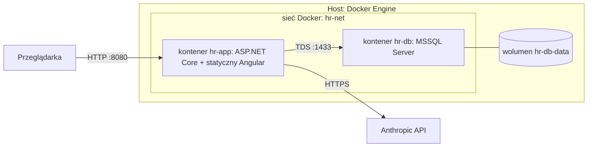

# 7. Widok wdrożenia

## 7.1 Infrastruktura
Jedna maszyna Linux (x86_64, 4 vCPU, 32 GB RAM), Docker Engine 24.0.9 i Docker Compose v2 (2.40.3).

| Element | Opis |
|---|---|
| `hr-app` | Obraz wieloetapowy: build Angulara, publikacja .NET, runtime ASP.NET. Wystawia port aplikacji. |
| `hr-db` | Obraz Microsoft SQL Server (Linux). Port 1433 tylko w sieci Docker, nie na hoście. Dane w wolumenie. |
| Sekrety | Klucz Anthropic API i hasło SA bazy z pliku `.env` (poza repozytorium, w `.gitignore`). |
| Start | `docker compose up`: kontener bazy, potem aplikacja z migracjami i seedem (UC-29). Healthcheck bazy. |

**Klucz Anthropic API:** aplikacja czyta go z `Anthropic:ApiKey` (konfiguracja) albo ze zmiennej środowiskowej `ANTHROPIC_API_KEY`; model z `Anthropic:Model` (domyślnie `claude-sonnet-5-5`). Lokalnie: `export ANTHROPIC_API_KEY=...` przed `dotnet run`, w Dockerze przez `.env` (plik jest w `.gitignore`; wzorzec `.env.example` nie zawiera wartości). Bez klucza endpointy agenta zwracają `503`, a reszta systemu działa. Opcjonalny test na prawdziwym API (`LiveSmokeTests`) jest domyślnie pomijany: uruchom go zmienną `RUN_LIVE_SMOKE=1` z ustawionym kluczem.

## 7.2 Konta demo (wyłącznie środowisko demonstracyjne, dane syntetyczne)
Konta tworzone seedem przy zakładaniu bazy. Hasło ma postać `imięnazwisko123` (małe litery, bez znaków diakrytycznych).

| Login | Hasło | Rola | Uwagi |
|---|---|---|---|
| `anna.nowak` | `annanowak123` | Employee | W zespole Ewy. |
| `jan.kowalski` | `jankowalski123` | Employee | W zespole Ewy. |
| `tomasz.lis` | `tomaszlis123` | Employee | Inny zespół, test separacji danych. |
| `ewa.wisniewska` | `ewawisniewska123` | Manager | Zespół: Anna, Jan. |
| `piotr.zielinski` | `piotrzielinski123` | HR | Tworzy zmiany płacowe. |
| `maria.kaminska` | `mariakaminska123` | HRApprover | Zatwierdza zmiany płacowe. |

**Pozostałe konta (wygenerowani pracownicy, ADR-19 i ADR-20, tylko profil `Full`):** login `imię.nazwisko`, hasło `imięnazwisko123` (małe litery, bez znaków diakrytycznych).
Profil `Full` zakłada 31 osób w pięciu zespołach: cztery zespoły biznesowe (`Zespół Ewy`, `Zespół B`, `Zespół C`, `Zespół D`, po 7 osób) i `Kadry` (3 osoby).
Wygenerowane osoby mają rolę `Employee`, a każdy zespół biznesowy ma dokładnie jednego `Manager` (w `Zespole Ewy` jest nim `ewa.wisniewska`).
Zespół `Kadry` (Piotr `HR`, Maria `HRApprover` i jedna osoba `Employee`) nie ma kierownika; wnioski jego członków i kierowników zespołów rozpatruje kadra.
Lista kont jest wyznaczona regułą i ziarnem generatora, więc nie jest tu powielana. Profil `Accounts` zakłada wyłącznie sześć kont z tabeli powyżej.

> **Ostrzeżenie:** hasła są jawne i przewidywalne, a polityka haseł jest świadomie poluzowana (decyzja ADR-06, ryzyko R-03).
> Nie wolno używać tego zestawu poza środowiskiem demonstracyjnym.

## 7.3 Dane demo
Dane demo (UC-29) zakłada aplikacja przy starcie, po migracjach i imporcie Kodeksu pracy, wyłącznie gdy `Hr:SeedDemoData=true`.
Klucze sekcji `Hr:` można nadpisać zmiennymi środowiskowymi (np. `Hr__DemoAnchorDate`); wartości domyślne są w kodzie (`DemoOptions`), nie w `appsettings.json`.

| Klucz | Domyślnie | Znaczenie |
|---|---|---|
| `Hr:SeedDemoData` | `false` | Włącza seed kont i danych demo. |
| `Hr:DemoAnchorDate` | `2026-10-16` | Kotwica („dziś” danych demo, ADR-28); musi być dniem roboczym, format `yyyy-MM-dd`. |
| `Hr:DemoSeed` | `20261016` | Ziarno generatora (liczba całkowita). |
| `Hr:DemoProfile` | `Full` | `Full`: pełny zbiór (31 osób, ewidencja, urlopy, zmiany płacowe, rozmowy, naliczenia); `Accounts`: tylko 3 zespoły i 6 kont z sekcji 7.2, bez danych (używany przez testy API). |

Niepoprawna wartość (zła data, kotwica w weekend lub święto, ziarno niebędące liczbą, nieznany profil) zatrzymuje start aplikacji wyjątkiem z komunikatem po polsku.

**Zakres (profil `Full`, kotwica `2026-10-16`):** ewidencja czasu pracy od 1.04.2026 do kotwicy (tylko dni robocze według `WorkCalendar`, z pominięciem
zatwierdzonych urlopów), wnioski urlopowe, zmiany płacowe, dwie zapisane rozmowy z agentem oraz naliczenia za kwiecień–wrzesień 2026, które liczy
`PayrollService` (ADR-27). Za październik naliczeń nie ma: miesiąc kotwicy jest otwarty.

**Scenariusze stałe** (testy UC i E2E mogą polegać wyłącznie na nich):

| Konto | Scenariusz | UC |
|---|---|---|
| `anna.nowak` | Naruszenie odpoczynku dobowego (<11 h) w ustalonym dniu września i jedno naruszenie tygodniowego (<35 h); wpis do korekty przez kadry. | 11, 12, 13, 26 |
| `jan.kowalski` | Nadgodziny w kilku miesiącach, w jednym z przekroczoną średnią 48 h; staż 12 lat (26 dni). | 10, 14, 16 |
| `tomasz.lis` | Poprawny przebieg bez alertów; staż poniżej 10 lat (20 dni); rozmowa z agentem. | 3, 24 |
| Anna (urlopy) | Wniosek oczekujący, zatwierdzony na przyszłość i zrealizowany; saldo spójne z wnioskami (20 dni wymiaru, 10 zatwierdzonych, 5 oczekujących, 5 pozostałych). | 5, 6, 8, 9 |
| Jan (urlopy) | Wniosek odrzucony z uzasadnieniem i anulowany. | 8, 9 |
| `piotr.zielinski`, `maria.kaminska` | Zmiana płacowa oczekująca (do zatwierdzenia przez Marię), zatwierdzona historycznie i odrzucona; oczekująca nie jest tworzona i zatwierdzana przez tę samą osobę. | 18, 19, 20 |
| wszyscy | Naliczenia za kwiecień–wrzesień; października brak. | 16, 17 |
| agent | Zapisana rozmowa Anny (do odczytu przez kadry z audytem) i rozmowa Tomasza. | 30, 31 |

**Idempotencja i istniejące bazy:** dane są zapisywane w jednej transakcji tylko wtedy, gdy nie ma konta `anna.nowak`; naliczenia tylko dla miesięcy bez wyników.
Seed nigdy nie nadpisuje ani nie usuwa danych. Jeśli w bazie nie ma pełnego zbioru osób profilu `Full` (np. dawna baza z sześcioma kontami
albo baza założona profilem `Accounts`), naliczenia są pomijane z wpisem w logu, bo bez ewidencji byłyby puste.
Dwie instancje aplikacji uruchomione jednocześnie na pustej bazie mogą się ścigać o znacznik seeda (konto `anna.nowak`), dlatego seed należy uruchamiać z jednej instancji.

**Audyt:** seed zapisuje przez `HrDbContext` z przechwytywaczem audytu i go nie wyłącza, więc jego wiersze (m.in. zespoły, pracownicy, wpisy czasu,
wnioski urlopowe, zmiany płacowe i naliczenia) mają w `AuditLog` wpisy z pustym aktorem (`ActorUserId = null`). To zamierzone: audyt pokazuje pochodzenie danych.

> **Ostrzeżenie (R-03):** wszystkie konta demo, także wygenerowane, mają jawne i przewidywalne hasła (`imięnazwisko123`), a polityka haseł jest poluzowana (ADR-06).
> Seed jest domyślnie wyłączony; włączaj go wyłącznie w środowisku demonstracyjnym z danymi syntetycznymi i nie wystawiaj takiej instancji do internetu.
