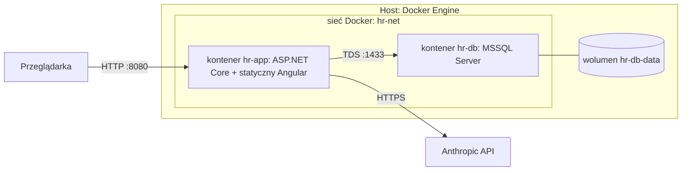

# 7. Widok wdrożenia

## 7.1 Infrastruktura
Jedna maszyna Linux (x86_64, 4 vCPU, 32 GB RAM), Docker Engine 24.0.9 i Docker Compose v2 (2.40.3).

| Element | Opis |
|---|---|
| `hr-app` | Obraz wieloetapowy: build Angulara, publikacja .NET, runtime ASP.NET. Wystawia port aplikacji. |
| `hr-db` | Obraz Microsoft SQL Server (Linux). Port 1433 tylko w sieci Docker, nie na hoście. Dane w wolumenie. |
| Sekrety | Klucz Anthropic API i hasło SA bazy z pliku `.env` (poza repozytorium, w `.gitignore`). |
| Start | `docker compose up`: kontener bazy, potem aplikacja z migracjami i seedem (UC-29). Healthcheck bazy. |

**Klucz Anthropic API:** aplikacja czyta go z `Anthropic:ApiKey` (konfiguracja) albo ze zmiennej środowiskowej `ANTHROPIC_API_KEY`; model z `Anthropic:Model` (domyślnie `claude-sonnet-5-5`). Lokalnie: `export ANTHROPIC_API_KEY=...` przed `dotnet run`, w Dockerze przez `.env` (plik jest w `.gitignore`; wzorzec `.env.example` nie zawiera wartości). Bez klucza endpointy agenta zwracają `503`, a reszta systemu działa. Opcjonalny test na prawdziwym API (`LiveSmokeTests`) jest domyślnie pomijany: uruchom go zmienną `RUN_LIVE_SMOKE=1` z ustawionym kluczem.

## 7.2 Konta demo (wyłącznie środowisko demonstracyjne, dane syntetyczne)
Konta tworzone seedem przy zakładaniu bazy. Hasło ma postać `imięnazwisko123` (małe litery, bez znaków diakrytycznych).

| Login | Hasło | Rola | Uwagi |
|---|---|---|---|
| `anna.nowak` | `annanowak123` | Employee | W zespole Ewy. |
| `jan.kowalski` | `jankowalski123` | Employee | W zespole Ewy. |
| `tomasz.lis` | `tomaszlis123` | Employee | Inny zespół, test separacji danych. |
| `ewa.wisniewska` | `ewawisniewska123` | Manager | Zespół: Anna, Jan. |
| `piotr.zielinski` | `piotrzielinski123` | HR | Tworzy zmiany płacowe. |
| `maria.kaminska` | `mariakaminska123` | HRApprover | Zatwierdza zmiany płacowe. |

**Pozostałe konta (wygenerowani pracownicy, ADR-19 i ADR-20):** login `imię.nazwisko`, hasło `imięnazwisko123` (małe litery, bez znaków diakrytycznych).
Rola `Employee`, a w każdym zespole jeden `Manager`. Lista jest wyznaczona regułą i ziarnem generatora, więc nie jest tu powielana.

> **Ostrzeżenie:** hasła są jawne i przewidywalne, a polityka haseł jest świadomie poluzowana (decyzja ADR-06, ryzyko R-03).
> Nie wolno używać tego zestawu poza środowiskiem demonstracyjnym.
